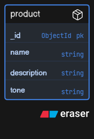

# HimShakti ListCraft Backend

## Run Locally

```bash
python -m venv venv

source venv/Scripts/activate

pip install fastapi uvicorn python-dotenv

uvicorn main:app --reload
```

Backend runs at

http://127.0.0.1:8000

Swagger Documentation

http://127.0.0.1:8000/docs

## Database

Database Used: MongoDB Atlas

Reason:
MongoDB was chosen because the application stores product information in a flexible document-based format, making it easy to extend with AI-generated descriptions and additional metadata.

## Database Schema

Product

- _id (ObjectId)
- name (String)
- description (String)
- tone (String)
## Database Schema



## Database Setup

1. Create a MongoDB Atlas cluster.
2. Create a database user.
3. Add your IP to Network Access.
4. Add MONGO_URI to the .env file.
5. Install dependencies:

```bash
pip install pymongo python-dotenv
```

6. Run:

```bash
uvicorn main:app --reload
<<<<<<< HEAD
```

Logout is implemented client-side by removing the JWT from localStorage.

 ## AI Features

- Google Gemini API Integration
- AI Product Description Generator
- Prompt-based Marketing Content
- Environment Variable API Key
- React Frontend + FastAPI Backend
=======
```
>>>>>>> bd449cb871fb2ecce69535a3274deb1ef5de895c
